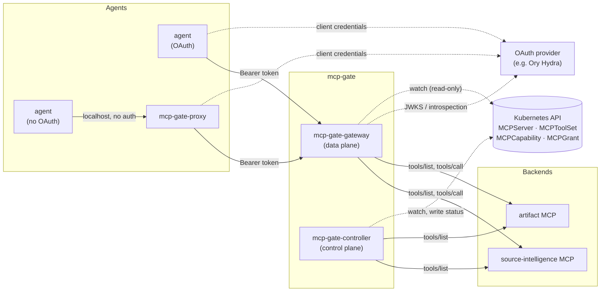

# mcp-gate

One governed MCP endpoint in front of every MCP backend in the cluster.

Agents connect to the gateway with an OAuth access token. The gateway discovers
the tools each backend offers, shows every caller exactly the tools its grants
allow, authorises every call again when it arrives, and forwards it to the
backend that owns the tool. What a subject may use is declared in four
Kubernetes resources; what the backends offer is never copied into them.

→ The design this implements: **[CONCEPT.md](./CONCEPT.md)**

---

## Architecture



| Component | Role |
|---|---|
| `mcp-gate-gateway` | The enforcement point. Verifies tokens, resolves the subject's grants, serves the filtered aggregate `tools/list`, authorises and routes every `tools/call`. Reads the API, never writes it. Every replica serves traffic. |
| `mcp-gate-controller` | Discovers backend catalogs, verifies tool sets against them, reports `Valid` and `Ready` on all four kinds. Not in the request path: the gateway keeps working when it is down. |
| `mcp-gate-proxy` | Optional. An auth-less MCP endpoint on localhost that obtains tokens itself, for agents that cannot do OAuth. Convenience, not a security boundary. |

→ **[Architecture](./docs/architecture.md)** — request flow, change detection, failure behaviour

## CRDs

All four kinds are **cluster-scoped**, in `mcp.gate.metapatrol.com/v1alpha1`.

```text
MCPServer ──> MCPToolSet ──> MCPCapability ──> MCPGrant ──> subject
```

| CRD | Says |
|---|---|
| **MCPServer** | Where a backend is. The tool catalog is discovered from it, not declared. |
| **MCPToolSet** | A subset of one server's tools. |
| **MCPCapability** | A useful ability, combining tool sets — possibly from several servers. |
| **MCPGrant** | Which capabilities a subject holds. |

```bash
kubectl get mcp-gate          # all four kinds at once
```

```text
NAME                                                    ENDPOINT                                        AVAILABLE   TOOLS   READY
mcpserver.mcp.gate.metapatrol.com/artifact              http://artifact.mcp-system.svc/mcp              true        3       True
mcpserver.mcp.gate.metapatrol.com/source-intelligence   http://source-intelligence.mcp-system.svc/mcp   true        4       True

NAME                                                              SERVER                VALID   READY
mcptoolset.mcp.gate.metapatrol.com/source-intelligence-analysis   source-intelligence   True    False
```

→ Full field reference: **[CRD Reference](./docs/crd-reference.md)**

## Quick Start

### 1. Install

```bash
helm install mcp-gate oci://zot.metapatrol.local/charts/platform/mcp-gate \
  --namespace mcp-system --create-namespace \
  --set gateway.oauth.issuer=https://hydra.example.com/ \
  --set gateway.oauth.introspection.url=http://hydra-admin.hydra.svc:4445/admin/oauth2/introspect
```

The chart refuses to render without `gateway.oauth.jwksURL` or
`gateway.oauth.introspection.url`: a gateway that cannot verify tokens cannot
serve anyone. → **[Authentication](./docs/authentication.md)**

### 2. Register backends, select tools, grant them

```yaml
apiVersion: mcp.gate.metapatrol.com/v1alpha1
kind: MCPServer
metadata:
  name: artifact
spec:
  endpoint: http://artifact.mcp-system.svc/mcp
---
apiVersion: mcp.gate.metapatrol.com/v1alpha1
kind: MCPToolSet
metadata:
  name: artifact-read
spec:
  serverRef: artifact
  tools: [artifact_search, artifact_get]
---
apiVersion: mcp.gate.metapatrol.com/v1alpha1
kind: MCPCapability
metadata:
  name: code-research
spec:
  toolSets: [artifact-read]
---
apiVersion: mcp.gate.metapatrol.com/v1alpha1
kind: MCPGrant
metadata:
  name: coding-agent
spec:
  subject: coding-agent        # the token's subject, see docs/authentication.md
  capabilities: [code-research]
```

More in [`samples/`](./samples).

### 3. Connect an agent

**Direct mode** — the agent does OAuth client credentials itself and connects to
`http://mcp-gate-gateway.mcp-system.svc/mcp` with `Authorization: Bearer <token>`.

**Proxy mode** — the agent connects to `http://127.0.0.1:8765/mcp` without
credentials, and `mcp-gate-proxy` next to it does the rest:

```bash
MCP_GATE_CLIENT_SECRET=... mcp-gate-proxy \
  --gateway-url=https://mcp-gate.example.com/mcp \
  --token-url=https://hydra.example.com/oauth2/token \
  --client-id=coding-agent
```

As a sidecar: [`samples/proxy-sidecar.yaml`](./samples/proxy-sidecar.yaml).

The gateway behaves identically in both modes; it cannot tell them apart.

## Observability

Both components serve Prometheus metrics on `:8080`, and the chart creates a
metrics Service for each; `serviceMonitor.enabled` renders a ServiceMonitor.

| Metric | Component | What it answers |
|---|---|---|
| `mcp_gate_resources{kind,ready}` | controller | How many of each kind are Ready. `False` and `Unknown` report zero rather than disappearing |
| `mcp_gate_discoveries_total{server,outcome}` | both | Catalog reads against each backend |
| `mcp_gate_backend_available{server}` | both | Whether the last discovery of a backend succeeded |
| `mcp_gate_discovered_tools{server}` | both | Catalog size per backend |
| `mcp_gate_tool_calls_total{server,tool,outcome}` | gateway | Forwarded calls: `ok`, `tool_error`, `backend_error` |
| `mcp_gate_tool_call_duration_seconds{server,tool}` | gateway | How long backends take |
| `mcp_gate_tool_calls_denied_total{subject}` | gateway | Calls refused for want of a grant |
| `mcp_gate_auth_failures_total{reason}` | gateway | Refused tokens, by reason: `missing_token`, `expired`, `audience`, `signature`, `unavailable`, … |
| `mcp_gate_build_info{component,…}` | all | Version, commit, build time, Go version |

controller-runtime's own `controller_runtime_*` and `workqueue_*` families come
with them. A Grafana dashboard built on all of them ships as a second chart,
[`charts/mcp-gate-grafana-dashboard`](./charts/mcp-gate-grafana-dashboard): tool
calls, access, backend availability, resource state, reconcilers and runtime.

Every tool call is logged by the gateway as an audit record — subject, client
ID, tool, backend, outcome and duration — and so is every refusal.

## Development

```bash
make generate               # deepcopy
make generate-crds          # CRD manifests → charts/mcp-gate/crds/
make build                  # compile everything
make build-binaries         # bin/mcp-gate-{controller,gateway,proxy}
make test                   # unit tests, with real in-process MCP backends
make integration-test       # controller + gateway against a real API server (envtest)
make lint                   # golangci-lint
make helm-lint              # lint both charts
make helm-docs              # regenerate the chart READMEs
```

The tests talk real MCP: backends in [`internal/mcptest`](./internal/mcptest)
are the SDK's own server behind a local listener, so sessions, notifications and
reconnects are exercised as they happen in production.

## License

Apache License 2.0
