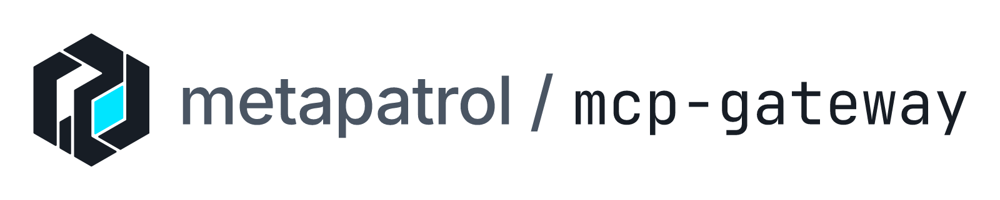
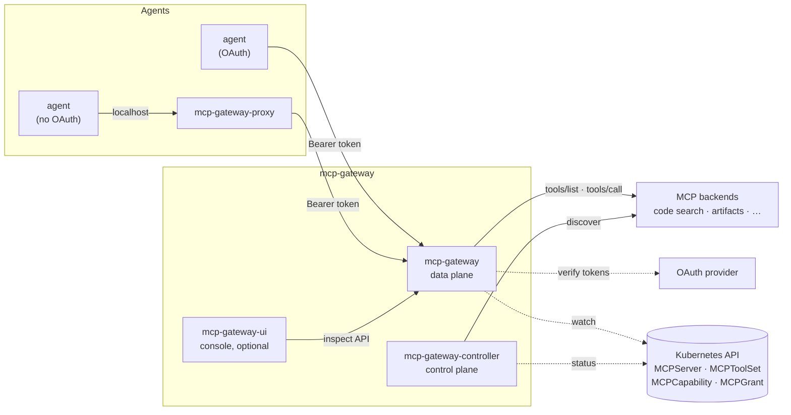
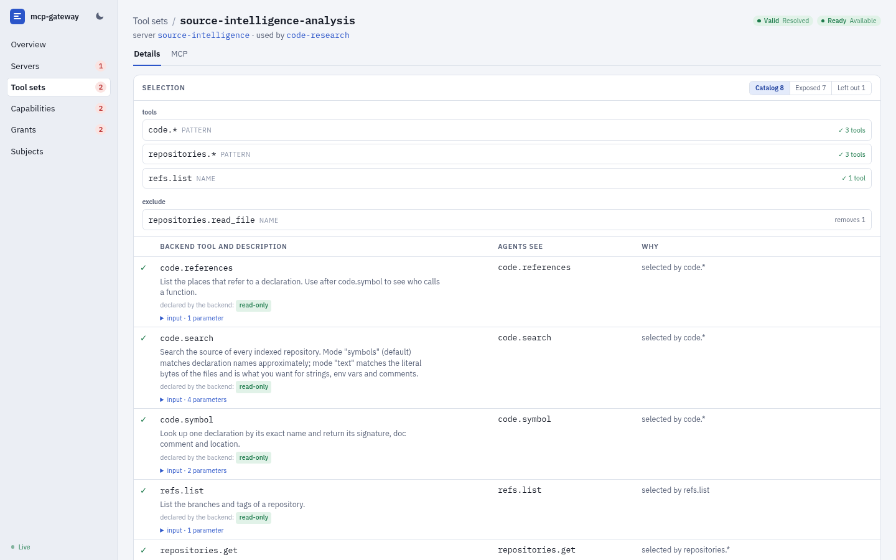

<p align="center">
  <picture>
    <source media="(prefers-color-scheme: dark)" srcset=".metapatrol/mcp-gateway-lockup-dark.png">
    
  </picture>
</p>

<p align="center">
  <strong>One governed MCP endpoint in front of every MCP backend in the cluster.</strong>
</p>

<p align="center">
  <a href="https://github.com/metapatrol/mcp-gateway/tags"></a>
  <a href="LICENSE"></a>
  <a href="https://github.com/metapatrol/mcp-gateway/pkgs/container/mcp-gateway"></a>
  
  
</p>

<p align="center">
  <a href="docs/installation.md">Installation</a> ·
  <a href="docs/README.md">Documentation</a> ·
  <a href="docs/faq.md">FAQ</a> ·
  <a href="docs/design.md">Design</a> ·
  <a href="CONTRIBUTING.md">Contributing</a> ·
  <a href="SECURITY.md">Security</a>
</p>

---

## Why

Agents get their tools from MCP servers, and a cluster soon has several: code
search, a knowledge base, tickets, deployments. Connecting every agent to every
server means every agent holds every server's credentials, sees every tool —
the destructive ones included — and nobody can say who may do what.

mcp-gateway puts one endpoint in front of all of them. Agents connect with an
OAuth access token. The gateway discovers what each backend offers, shows every
caller exactly the tools its grants allow, authorises every call again when it
arrives, and forwards it to the backend that owns the tool, with that
backend's credentials. Who may use what is declared in four Kubernetes
resources; what the backends offer is never copied into them.

## How it works



- **The gateway** is the enforcement point. It verifies tokens, resolves each
  subject's grants against the catalogs it discovered, and forwards calls.
  Every replica serves traffic, and it never writes to the API.
- **The controller** discovers catalogs too, verifies every resource against
  them and reports `Valid` and `Ready`. It is not in the request path: the
  gateway keeps working when it is down.
- **The proxy** is for agents that cannot do OAuth; **the console** shows what
  every subject actually gets.

```text
MCPServer ──> MCPToolSet ──> MCPCapability ──> MCPGrant ──> subject
where it is   which tools    a useful ability  who holds it
```

## Features

**Access control**

- Tools granted per subject, through reusable tool sets and capabilities that
  may span backends.
- Tool sets select by name or glob pattern (`code.*`), with exclusions, and
  can rename what they select with a prefix or aliases.
- Every call is authorised again, against the current grants. A tool outside
  a subject's grants is invisible: not listed, not described, and refused with
  the error a nonexistent tool gets.
- Fail closed: a broken reference or a name claimed by two backends narrows
  access, never widens it.

**Backends**

- Catalogs are discovered over MCP, and followed as they change — a backend's
  `tools/list_changed` reaches connected agents.
- Credentials per backend: none, an API key, an OAuth client of the gateway's
  own, or the calling agent's own token — only where a backend asks for it.
- Backends' instructions are passed on, from the backends a subject holds
  tools from.
- One broken backend is not an outage: its tools drop out, the others stay.

**Operations**

- Agents speak MCP 2026-07-28, without sessions: any replica answers any
  request.
- OAuth 2.0 with any provider: JWTs against a JWKS, or RFC 7662 introspection;
  RFC 9728 protected resource metadata.
- Prometheus metrics, a Grafana dashboard chart, and an audit record for every
  call and every refusal.
- A read-only console that shows, for any tool set or subject, which tools it
  comes to and why — and the exact MCP answers an agent receives.



## Quick start

You need a Kubernetes cluster, an OAuth provider that issues access tokens by
the client credentials grant, and MCP backends that speak Streamable HTTP.

1. **Install** the chart, telling it how to verify tokens:

   ```bash
   helm install mcp-gateway oci://ghcr.io/metapatrol/charts/mcp-gateway \
     --namespace mcp-system --create-namespace \
     --set gateway.oauth.issuer=https://id.example.com/ \
     --set gateway.oauth.jwksURL=https://id.example.com/.well-known/jwks.json
   ```

2. **Declare** a backend, the tools to hand out, and who gets them:

   ```yaml
   apiVersion: mcp-gateway.metapatrol.com/v1alpha1
   kind: MCPServer
   metadata:
     name: artifact
   spec:
     endpoint: http://artifact.mcp-system.svc/mcp
   ---
   apiVersion: mcp-gateway.metapatrol.com/v1alpha1
   kind: MCPToolSet
   metadata:
     name: artifact-read
   spec:
     serverRef: artifact
     tools: [artifact_search, artifact_get]
   ---
   apiVersion: mcp-gateway.metapatrol.com/v1alpha1
   kind: MCPCapability
   metadata:
     name: code-research
   spec:
     toolSets: [artifact-read]
   ---
   apiVersion: mcp-gateway.metapatrol.com/v1alpha1
   kind: MCPGrant
   metadata:
     name: coding-agent
   spec:
     subject: coding-agent        # the token's subject: by default its sub claim
     capabilities: [code-research]
   ```

3. **Connect** the agent to `http://mcp-gateway.mcp-system.svc/mcp` with its
   access token — or to `mcp-gateway-proxy` on `127.0.0.1:8765`, if it cannot
   do OAuth.

```bash
kubectl get mcp-gateway          # all four kinds, with what each resolves to
```

The [installation guide](docs/installation.md) walks through every step,
including the network policies that keep agents from going around the gateway.

## Documentation

| | |
|---|---|
| [Installation](docs/installation.md) | from an empty cluster to an agent calling its first tool |
| [CRD Reference](docs/crd-reference.md) | every field and condition of the four kinds |
| [Authentication](docs/authentication.md) | tokens, subjects, credentials towards backends, the proxy |
| [Console](docs/console.md) | what the console shows, and how data reaches it |
| [Operations](docs/operations.md) | metrics, alerts, audit records, troubleshooting, upgrades |
| [Architecture](docs/architecture.md) | how it works inside |
| [FAQ](docs/faq.md) | why discovery, why cluster scope, why only MCP 2026-07-28, and more |
| [Development](docs/development.md) | building, testing and changing it |
| [Design](docs/design.md) | the design record: the model and the decisions behind it |

## Status

mcp-gateway is in the 1.x series and runs in front of the maintainers' own MCP
backends. Its API is `v1alpha1`: a change that breaks manifests is announced as
breaking in the [changelog](CHANGELOG.md). Not yet supported: token exchange,
mTLS and workload identity towards backends.

## Contributing

This repository is developed in a private Forgejo and published here. Open
issues and pull requests on GitHub as usual;
[forgejo-github-bridge](https://github.com/metapatrol/forgejo-github-bridge)
carries them to the maintainers, and their answers come back the same way.
See [CONTRIBUTING.md](CONTRIBUTING.md).

## License

[Apache License 2.0](LICENSE)
