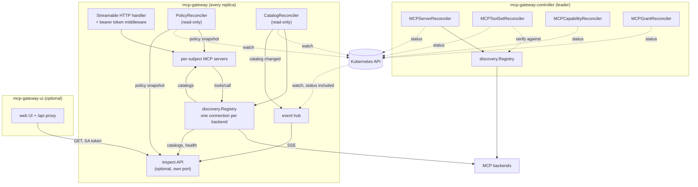
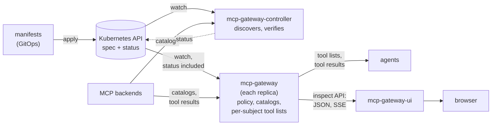
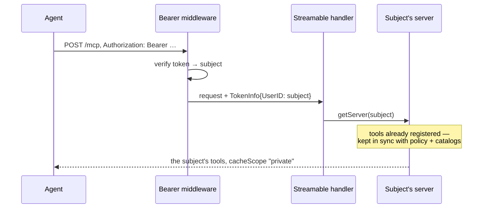
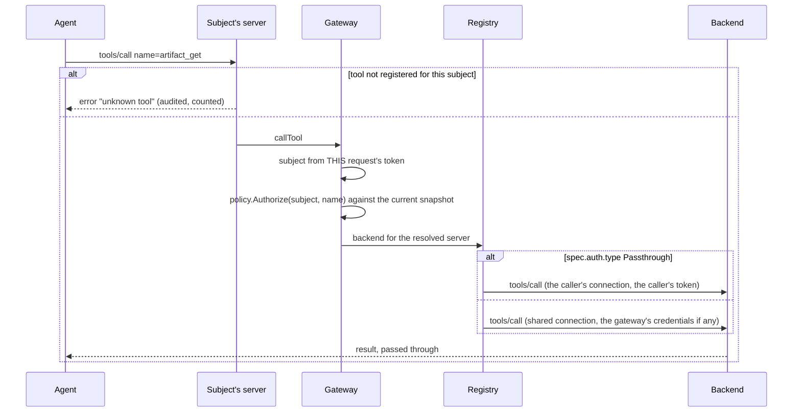
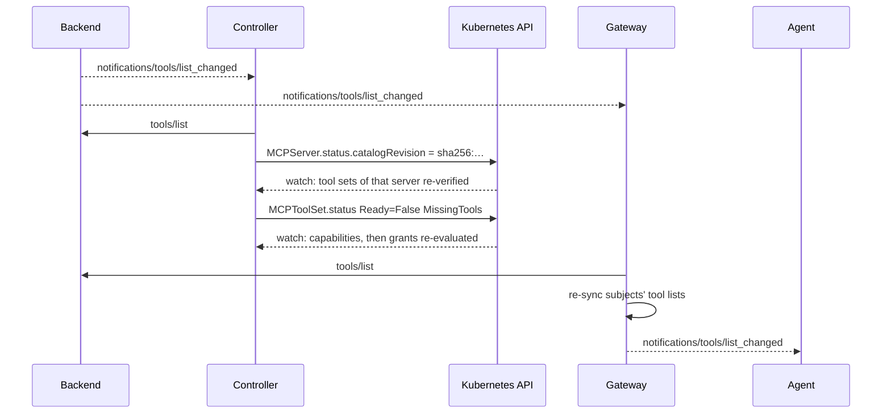

# Architecture — mcp-gateway

How the pieces fit, what happens on a request, and what happens when something
breaks. The design goals are in the [design record](./design.md); this is how the
implementation meets them.

---

## Components



| Package | Holds |
|---|---|
| `api/v1alpha1` | The four kinds, their conditions and reasons |
| `internal/policy` | Resolution: grant → capability → tool set → backend tool. Pure, shared by both components |
| `internal/discovery` | MCP client side: one connection per backend, a listener for its notifications, catalogs, forwarding |
| `internal/auth` | Token verification: JWT against a JWKS, opaque tokens by RFC 7662 introspection |
| `internal/gateway` | The data plane: HTTP handler, per-subject servers, authorisation, the gateway's reconcilers |
| `internal/controller` | The control plane: verification and status |
| `internal/proxy` | `mcp-gateway-proxy` |
| `internal/metrics` | Prometheus metrics of the gateway, the controller and the proxy |
| `internal/inspect` | The gateway's read-only inspect API and its event stream; `internal/inspect/api` is generated from `api/openapi/inspect.yaml` |
| `internal/ui` | `mcp-gateway-ui`: serves the embedded web UI and passes `/api` on to the inspect API |
| `web/ui` | The console's web UI (Angular); its API client is generated from the same spec |

## Data flows

Three flows cross the system. Declarations go from the manifests into the
Kubernetes API and from there, by watch, into every process that needs them.
Catalogs go from the backends into the controller and into each gateway replica,
which discover independently. What the gateway makes of both goes out to agents
and, optionally, to the console. Nothing flows back into a manifest, and only
the controller writes anything — status.

Arrows point the way the data goes; requests go the other way — an agent's
`tools/call` travels from the agent through the gateway to the backend, and its
result comes back along the arrows.



- **Declarations.** The four kinds are written once — by Flux, kubectl, whoever
  — and read by watch: the controller verifies them against catalogs and writes
  status; each gateway replica builds its policy snapshot from them. The gateway
  never waits for status, and never writes.
- **Catalogs.** Backends are read over MCP by the controller, for status, and
  by each gateway replica, for serving. A backend that announces
  `notifications/tools/list_changed` is read again at once; the others on their
  `discoveryInterval`.
- **Agent requests.** An agent's `tools/list` is answered from the subject's
  tool list, kept in memory; its `tools/call` is authorised again and forwarded
  to the backend. See [Request flow](#request-flow).
- **Console requests.** The console reads the inspect API, which answers from
  the same informer cache, catalogs and resolution the MCP endpoint uses, and
  streams an event whenever one of them changes. See
  [Console](./console.md#data-flows) for the details of that path.

## Why the controller is not in the request path

The gateway does not ask the controller anything. It watches the four kinds
itself, builds its own policy snapshot from them, and discovers backend catalogs
itself. The controller discovers too, and writes what it finds into status.

Discovering twice costs one `tools/list` per backend per interval. What it buys:

- A controller that is down, restarting or losing its leader lease delays nothing
  an agent does.
- Enforcement never depends on status, which is derived data and written by a
  different process. The gateway enforces the manifests; status explains them.

Both sides resolve through the same `internal/policy` code, so the status a
resource shows describes what the gateway does with it.

## Cluster scope

All four kinds are cluster-scoped. The gateway reaches every backend it routes to
and is the network boundary in front of them. Whoever may create an `MCPServer`
decides where that reach is pointed, and whoever may create an `MCPGrant` decides
who uses it. A subject is global — a token is not issued to a namespace — so a
grant is cluster-wide policy by nature.

A namespaced model would hand both decisions to every namespace: a tenant could
register another team's backend under a name of their own and grant themselves
access to it. Preventing that needs cross-namespace references and an
`allowedFrom` on the referenced side, which the first version does without.

The same reasoning settles where backend credentials come from ([design §16](./design.md#16-credentials-towards-backends)). A
cluster-scoped `MCPServer` that could name a Secret in any namespace would let
whoever may create one have the gateway read any Secret in the cluster. So a
Secret reference has no namespace: Secrets are read from the namespace the
gateway and the controller run in, and the chart grants them `get` on Secrets
there and nowhere else. Registering a backend with credentials takes access to
that namespace, which is the access the gateway's own configuration takes.

## Request flow

### tools/list



The gateway keeps one MCP server per subject. Its registered tools are, at all
times, what the subject's grants resolve to against the catalogs currently usable:

```text
for each tool set the subject's grants reach:
    its exact names                        (claimed whether or not the backend has them)
    and its patterns, expanded against the server's usable catalog
    minus its exclusions
each named as agents see it: its alias, or the set's prefix and its backend name
for each name claimed by exactly one (server, tool):
    the server's catalog is usable        (discovered, not failing for longer than --catalog-max-age)
    and the catalog contains the tool
    → exposed under that name, with the backend's definition
```

When the policy or a catalog changes, every subject's list is recomputed and only
the differences are applied. The SDK then sends
`notifications/tools/list_changed` on every `subscriptions/listen` stream the
subject holds open. A catalog
change alone can therefore change what a subject gets: a pattern like `code.*`
picks up a tool the backend adds, with no manifest touched.

Resolution is `internal/policy`, a pure function of the manifests and the
catalogs' tool names, and the controller calls the same function with its own
catalogs — so the `resolvedTools` of a tool set and the conflicts a capability
reports describe what the gateway enforces.

### Instructions

Backends tell clients how to use their tools in their `instructions`. The
gateway reads them at discovery and passes them on in its own `server/discover`
answer — assembled per request, from the backends the subject holds at least one
tool from, after a text of the gateway's own if one is configured:

```text
<the gateway's own instructions, if any>

## artifact

Tools from this server: artifact_get, artifact_search

<the artifact backend's instructions>

## source-intelligence

Tools from this server: code.search, code.symbol

<the source-intelligence backend's instructions>
```

The gateway's own text is for what applies to every tool, whichever backend it
comes from — house rules, the platform's conventions. It is set with
`--instructions`, or `--instructions-file` for more than a line; the chart takes
it as `gateway.instructions`, puts it in a ConfigMap, and rolls the gateway when
it changes, since it is read at startup. Every agent gets it, including one
whose grants reach no backend.

A backend the subject has no tool from contributes nothing, so its instructions
reveal nothing about it. The tool line is there because tools are exposed under
their bare names: without it a model cannot tell which of its tools a sentence
refers to. A backend's text is passed on as written, including anything it says
about tools the subject was not granted.

Instructions are part of the catalog revision. A backend redeployed with a new
note and the same tools is a changed catalog, and the next `server/discover`
answers with the new text. A client that does not ask again keeps what it was
told — the protocol has no notification for changed instructions.

### tools/call



Authorisation is decided on every call, from the current snapshot and the token
on that request. The registered tool list is not trusted for it: a grant revoked
a millisecond ago is refused even if the list has not caught up. The check does
not resolve the subject's whole policy: each tool set the subject reaches is
asked only whether it exposes the requested name, by the same rules as the
resolution — a few microseconds however large the policy grows.

A refused call gets exactly the error a nonexistent tool gets, so a caller cannot
probe for tools outside its grants.

An agent that sends a `progressToken` gets the backend's progress. The call goes
to the backend with a token of the gateway's own, unique to the call — the client
towards a backend is shared by every caller — and each notification the backend
sends against it goes back to the agent against the agent's token. The SDK
delivers a response ahead of the notification queue, so the gateway waits briefly
after the answer for notifications the backend sent before it: not at all when
the last one reported the work complete, otherwise until none has come for 25 ms,
at most 250 ms.

A backend failure comes back as a tool result with `isError: true` — something
the model can see and work around — and the cause is logged rather than returned,
since it carries backend addresses.

### Protocol and replicas

Agents speak **MCP 2026-07-28** to the gateway, and nothing older. That version has
no sessions: every request carries its own identity and is answered on its own,
and a client that wants to hear about changes keeps a `subscriptions/listen`
stream open. A client of a session-based version is refused; the gateway keeps
no compatibility layer for a superseded specification.

That is what makes replicas plain. Any replica answers any request, nothing pins
an agent to one, and every replica keeps each subject's tools in step with the
API on its own — so a listen stream held by one replica hears about a grant
change as soon as that replica has applied it. Scale the Deployment; no ingress
affinity is needed.

Towards backends the protocol is the SDK's to negotiate: 2026-07-28 with a
backend that speaks it, the backend's newest session-based version with one
that does not. Backends are not the gateway's to choose, and talking to an older
one takes no code of the gateway's own.

Requests go out on **one client connection per backend**, shared by every
caller. When a session-based backend restarts and no longer knows the session,
the request is retried once on a new one — only for failures where the backend
provably did not receive the request; a tool call is never repeated on a guess.

A `Passthrough` backend that speaks MCP 2026-07-28 shares that connection too:
without sessions there is nothing to bind a token to, and each call carries its
caller's token on its own request. A session-based `Passthrough` backend is the
exception. It binds a session to the identity that opened it, so each caller
token gets a connection of its own for its tool calls, and the shared connection
reads the catalog. Caller connections are keyed by a hash of the token rather
than by the gateway's subject — the backend decides who a token is, and two
tokens the gateway maps to one subject can be two identities to it. They close
after five minutes without calls. That separation is what Passthrough costs on a
session-based backend under load — in the load test about a quarter more CPU per
call and a longer tail — and what it no longer costs on one that has no sessions.

Change notifications from a backend arrive on a connection of its own, the
**listener**, kept open in the background: a `subscriptions/listen` stream, or
the notification stream of a session-based backend. Opening a listen stream can
hang on a backend that accepts the request and never answers, and the SDK waits
for that answer without a deadline; on its own connection, bounded by the
connect timeout and retried with backoff, that costs neither a catalog read nor
a tool call anything. The listener also notices a listen stream that ends —
which the SDK does not report — and connects again.

Credentials are added by a per-connection HTTP transport, which also turns a 401
or 403 into a transport error. The SDK ends a session on an HTTP error it cannot
decode; a refused request must not end one that other callers share.
See [Authentication](./authentication.md#towards-backends).

## Change detection



Three things trigger a rediscovery, in both components:

1. The backend sends `notifications/tools/list_changed`, heard by the backend's
   listener — on its `subscriptions/listen` stream, or the notification stream of
   a session-based backend.
2. The server's `spec.discoveryInterval` elapses (default 1m, minimum 10s).
3. In the gateway only: `status.catalogRevision` changes — the controller saw a
   catalog this replica may not have yet.

The catalog revision is a sha256 over the canonical JSON of all tool definitions,
so a changed description or schema is a change, and a rediscovery that finds the
same catalog changes nothing and notifies no one.

## Status

| Kind | `Valid` | `Ready` |
|---|---|---|
| MCPServer | — | discovery succeeded (`Discovered` / `DiscoveryFailed`, `CredentialsUnavailable`, `Unauthorized`) |
| MCPToolSet | server exists (`ServerNotFound`) | server Ready, every name exposed, every pattern selects something, every alias names a selected tool, no two tools renamed alike (`ServerUnavailable`, `ToolNameConflict`, `MissingTools`, `UnmatchedPatterns`, `UnusedAliases`, `CatalogPending`) |
| MCPCapability | tool sets exist, no name conflict (`ToolSetNotFound`, `ToolNameConflict`) | every tool set Ready (`ToolSetNotReady`) |
| MCPGrant | capabilities exist, no name conflict (`CapabilityNotFound`, `ToolNameConflict`) | every capability Ready, no conflict with the subject's other grants (`CapabilityNotReady`, `ToolNameConflict`) |

A `Ready=True` counts only if it was recorded for the dependency's current
generation.

## Failure behaviour

| What happens | Effect |
|---|---|
| A backend is unreachable | Its tools stay listed for `--catalog-max-age` (5m), calls to them return a tool error; then they drop out of the lists until discovery succeeds again. Other backends are unaffected. The server goes `Ready=False`, its tool sets follow. |
| A tool disappears from a backend | It is no longer exposed; the rest of its tool set is. The tool set reports `MissingTools`. |
| A grant names a capability that does not exist | That name grants nothing; the rest of the grant still applies. `Valid=False, CapabilityNotFound`. An unresolved reference can narrow access, never widen it. |
| Two backends expose the same name to one subject | Neither is exposed. The capability or grant reports `ToolNameConflict`, naming both. With patterns this can happen when a backend adds a tool. |
| A Secret named in `spec.auth` is missing | The backend is registered and its discovery fails: `Ready=False, CredentialsUnavailable`, naming the Secret and its keys. It recovers within seconds of the Secret appearing. |
| A backend refuses the gateway's credentials | The token is replaced, or the Secret re-read, and the request sent once more. If it is still refused: `Ready=False, Unauthorized`; tool calls return the "unavailable" tool error. The shared session survives. |
| A `Passthrough` backend refuses an agent's token | That call returns a tool error saying the backend refused the caller's credentials. Other callers, and discovery, are unaffected. |
| A pattern matches nothing | It selects nothing; the rest of the tool set still applies. The tool set reports `UnmatchedPatterns`. |
| The OAuth provider is down | JWTs keep verifying against the last fetched key set. Introspection fails with 500, not 401, so clients do not start refetching tokens from the provider that is down. |
| The controller is down | Nothing changes for agents. Status goes stale. |
| The gateway starts before the API is readable | It is not ready until it has built its first policy snapshot, and serves no traffic before. |

## Inspect API

The console needs things only a running gateway has: backend catalogs with each
tool's description and input schema, the instructions a subject is sent, and why
a tool set selects what it does. Status cannot carry them, because a catalog can
be megabytes. The gateway serves them itself, read-only, on a listener of its
own (`--inspect-bind-address`, off by default), behind a Service of its own.
The MCP listener never serves it: it shows every subject's grants and every
backend's catalog, and agents must not read that.

It is defined in [`api/openapi/inspect.yaml`](../api/openapi/inspect.yaml),
and the spec comes first. `make generate-api` generates the types and the
server interface from it, and `internal/inspect` implements that interface, so
a handler that strays from the spec does not compile. A test regenerates the
code and fails when the committed file is stale; another fails when a field of
the four kinds is missing from the spec.

Readers authenticate with a ServiceAccount token issued for the audience
`mcp-gateway-inspect`, which the gateway checks by TokenReview against
`--inspect-service-accounts`. The pod's default token is refused: it is good
for the Kubernetes API, and a token that opened both would be worth more to
whoever captured it.

The description itself is public: `GET /api/v1alpha1/openapi.yaml` is the
embedded spec the code was generated from, byte for byte, and
`/api/v1alpha1/openapi.json` the same as JSON. `GET /.well-known/api-catalog`
([RFC 9727](https://www.rfc-editor.org/rfc/rfc9727)) links to both, so a tool
given only the host finds them. None of the three takes a token; what the API
offers is no secret, what it answers is.

`GET /events` is a stream of server-sent events that says what changed — a
kind and a name — and never what to: the reader reads again through the other
operations, so the data has one way out. It hears every change the replica's
informers see to the four kinds, status included, and a backend's catalog
changing or its discovery starting or stopping to fail. The controller's
routine `lastDiscoveryTime` write is not a change. Changes are collected for
250ms and sent as one batch, so a GitOps sync of fifty grants is one event.
Nothing is replayed: a reader that reconnects reads everything again. SSE rather
than WebSocket because the traffic goes one way, a stream is an ordinary GET
that OpenAPI describes and a reverse proxy passes on, and browsers reconnect by
themselves.

Every answer is one replica's view and says which (`source.replica`). Replicas
discover independently, so two of them can differ for up to a discovery
interval. Resolution goes through `internal/policy` against the catalogs the
gateway serves, and `policy.Explain` keeps the reasons `policy.Select` drops;
its selection is `Select`'s, so the explanation cannot disagree with
enforcement.

## Console

`mcp-gateway-ui` is the console: an Angular application (`web/ui`) compiled
into a small Go server. The browser talks to the inspect API at the paths the
gateway serves it under, and the server passes those requests on — GET and
HEAD only, without the browser's cookies or credentials, with its own
ServiceAccount token, projected for the audience `mcp-gateway-inspect`. There
is one API and one spec: the console's client is generated from
`api/openapi/inspect.yaml` on every UI build, so a change to the spec that the
UI does not follow fails its build. It reads again whenever the event stream
names a change, and polls while it cannot have the stream.

It has no sign-in of its own and keeps nothing. Who may open it is decided in
front of it: a port-forward, or an ingress with an authenticating proxy.

→ **[Console](./console.md)** — enabling it, what it shows, its data flows,
`make dev-stack`

## Network model

The gateway is the boundary between agents and backends. The chart's
`networkPolicy` covers the gateway's side — who may call it. The side that matters
more, that agents cannot reach a backend directly, belongs in each backend's
namespace:

```yaml
apiVersion: networking.k8s.io/v1
kind: NetworkPolicy
metadata:
  name: only-mcp-gateway
  namespace: mcp-system            # the backend's namespace
spec:
  podSelector:
    matchLabels:
      app.kubernetes.io/name: artifact
  policyTypes: [Ingress]
  ingress:
    - from:
        - namespaceSelector:
            matchLabels:
              kubernetes.io/metadata.name: mcp-gateway   # where the chart is installed
          podSelector:
            matchLabels:
              app.kubernetes.io/name: mcp-gateway
              app.kubernetes.io/component: gateway
```

Allow the controller the same way if its discovery should work too
(`app.kubernetes.io/component: controller`), or accept that the tool sets of that
backend report `ServerUnavailable`.

## Not in this version

- **Token exchange, mTLS, workload identity** towards backends ([design §16](./design.md#16-credentials-towards-backends)).
  `spec.auth` covers no credentials, passthrough, client credentials and API
  keys; another type is another variant of the union and another
  `credentials.Credential`.
- **Prompts, resources, sampling, elicitation.** The gateway aggregates tools
  only.
