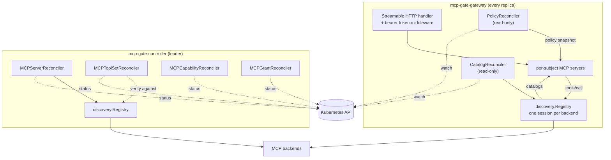
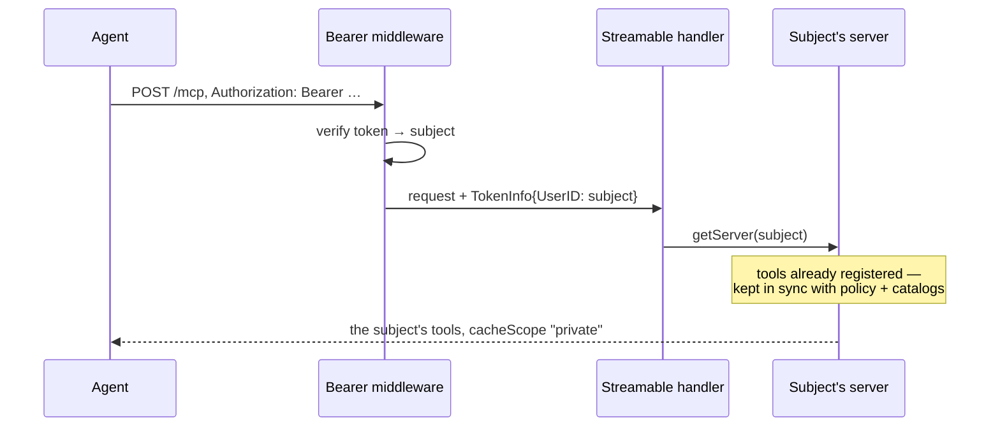
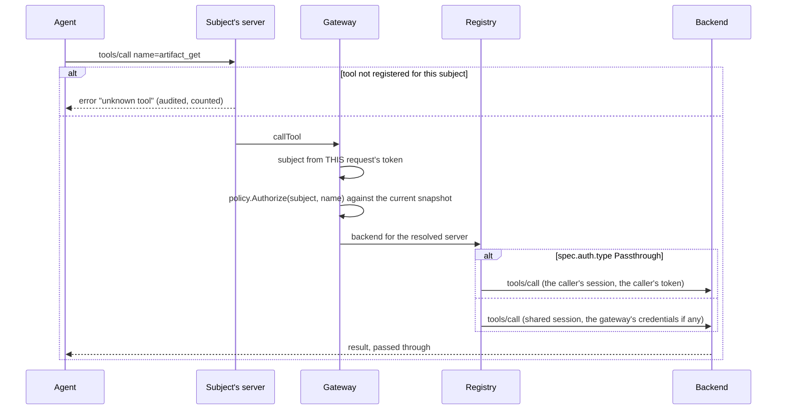
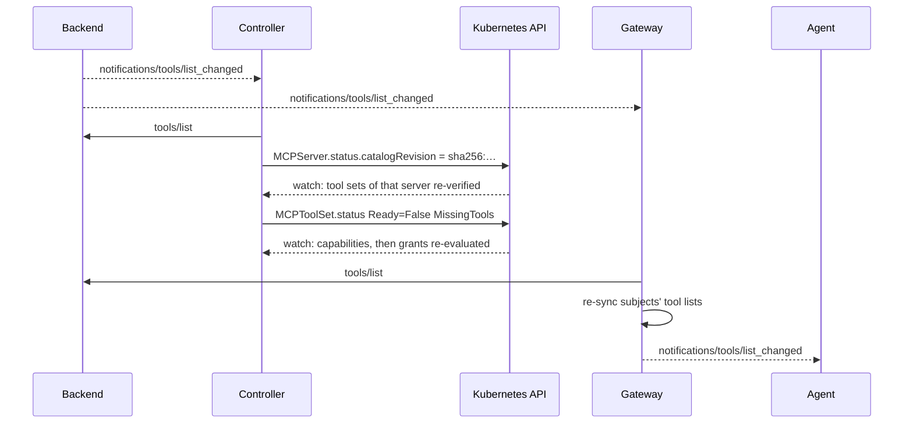

# Architecture — mcp-gate

How the pieces fit, what happens on a request, and what happens when something
breaks. The design goals are in [CONCEPT.md](../CONCEPT.md); this is how the
implementation meets them.

---

## Components



| Package | Holds |
|---|---|
| `api/v1alpha1` | The four kinds, their conditions and reasons |
| `internal/policy` | Resolution: grant → capability → tool set → backend tool. Pure, shared by both components |
| `internal/discovery` | MCP client side: one session per backend, catalogs, forwarding |
| `internal/auth` | Token verification: JWT against a JWKS, opaque tokens by RFC 7662 introspection |
| `internal/gateway` | The data plane: HTTP handler, per-subject servers, authorisation, the gateway's reconcilers |
| `internal/controller` | The control plane: verification and status |
| `internal/proxy` | `mcp-gate-proxy` |
| `internal/metrics` | Prometheus metrics of all three binaries |

## Why the controller is not in the request path

The gateway does not ask the controller anything. It watches the four kinds
itself, builds its own policy snapshot from them, and discovers backend catalogs
itself. The controller discovers too, and writes what it finds into status.

Discovering twice costs one `tools/list` per backend per interval. What it buys:

- A controller that is down, restarting or losing its leader lease delays nothing
  an agent does.
- Enforcement never depends on status, which is derived data and written by a
  different process. The gateway enforces the manifests; status explains them.

Both sides resolve through the same `internal/policy` code, so the status a
resource shows describes what the gateway does with it.

## Cluster scope

All four kinds are cluster-scoped. The gateway reaches every backend it routes to
and is the network boundary in front of them. Whoever may create an `MCPServer`
decides where that reach is pointed, and whoever may create an `MCPGrant` decides
who uses it. A subject is global — a token is not issued to a namespace — so a
grant is cluster-wide policy by nature.

A namespaced model would hand both decisions to every namespace: a tenant could
register another team's backend under a name of their own and grant themselves
access to it. Preventing that needs cross-namespace references and an
`allowedFrom` on the referenced side, which the first version does without.

The same reasoning settles where backend credentials come from (CONCEPT §16). A
cluster-scoped `MCPServer` that could name a Secret in any namespace would let
whoever may create one have the gateway read any Secret in the cluster. So a
Secret reference has no namespace: Secrets are read from the namespace the
gateway and the controller run in, and the chart grants them `get` on Secrets
there and nowhere else. Registering a backend with credentials takes access to
that namespace, which is the access the gateway's own configuration takes.

## Request flow

### tools/list



The gateway keeps one MCP server per subject. Its registered tools are, at all
times, what the subject's grants resolve to against the catalogs currently usable:

```text
for each tool set the subject's grants reach:
    its exact names                        (claimed whether or not the backend has them)
    and its patterns, expanded against the server's usable catalog
    minus its exclusions
for each tool claimed by exactly one (server, tool):
    the server's catalog is usable        (discovered, not failing for longer than --catalog-max-age)
    and the catalog contains the tool
    → exposed under the tool's own name, with the backend's definition
```

When the policy or a catalog changes, every subject's list is recomputed and only
the differences are applied. The SDK then sends
`notifications/tools/list_changed` to that subject's open sessions. A catalog
change alone can therefore change what a subject gets: a pattern like `code.*`
picks up a tool the backend adds, with no manifest touched.

Resolution is `internal/policy`, a pure function of the manifests and the
catalogs' tool names, and the controller calls the same function with its own
catalogs — so the `resolvedTools` of a tool set and the conflicts a capability
reports describe what the gateway enforces.

### Instructions

Backends tell clients how to use their tools in the `instructions` of their
initialize result. The gateway reads them at discovery and passes them on in its
own `initialize` (and `server/discover`, under the stateless protocol) — assembled
per request, from the backends the subject holds at least one tool from:

```text
## artifact

Tools from this server: artifact_get, artifact_search

<the artifact backend's instructions>

## source-intelligence

Tools from this server: code.search, code.symbol

<the source-intelligence backend's instructions>
```

A backend the subject has no tool from contributes nothing, so its instructions
reveal nothing about it. The tool line is there because tools are exposed under
their bare names: without it a model cannot tell which of its tools a sentence
refers to. A backend's text is passed on as written, including anything it says
about tools the subject was not granted.

Instructions are part of the catalog revision. A backend redeployed with a new
note and the same tools is a changed catalog, and sessions started afterwards get
the new text. A session keeps what it was given at initialize — the protocol has
no notification for changed instructions.

### tools/call



Authorisation is decided on every call, from the current snapshot and the token
on that request. The registered tool list is not trusted for it: a grant revoked
a millisecond ago is refused even if the list has not caught up.

A refused call gets exactly the error a nonexistent tool gets, so a caller cannot
probe for tools outside its grants.

A backend failure comes back as a tool result with `isError: true` — something
the model can see and work around — and the cause is logged rather than returned,
since it carries backend addresses.

### Sessions

By default the gateway keeps sessions: needed for change notifications. A session
is bound to the subject that opened it; continuing it with another subject's token
is refused by the SDK. With several replicas, sessions need an ingress that pins
a client to a replica — or `--stateless`, which lets any replica answer any
request and gives up notifications.

Towards backends, the gateway holds **one session per backend** shared by every
caller. When a backend restarts and no longer knows the session, the request is
retried once on a new one — only for failures where the backend provably did not
receive the request; a tool call is never repeated on a guess.

A `Passthrough` backend is the exception. A session is bound to the identity that
opened it, so each caller token gets a session of its own for its tool calls,
without the notification stream; the shared session reads the catalog and hears
about changes. Caller sessions are keyed by a hash of the token rather than by
the gateway's subject — the backend decides who a token is, and two tokens the
gateway maps to one subject can be two identities to it. They close after five
minutes without calls.

Credentials are added by a per-session HTTP transport, which also turns a 401 or
403 into a transport error. The SDK ends a session on an HTTP error it cannot
decode; a refused request must not end one that other callers share.
See [Authentication](./authentication.md#towards-backends).

## Change detection



Three things trigger a rediscovery, in both components:

1. The backend sends `notifications/tools/list_changed` over the session.
2. The server's `spec.discoveryInterval` elapses (default 1m, minimum 10s).
3. In the gateway only: `status.catalogRevision` changes — the controller saw a
   catalog this replica may not have yet.

The catalog revision is a sha256 over the canonical JSON of all tool definitions,
so a changed description or schema is a change, and a rediscovery that finds the
same catalog changes nothing and notifies no one.

## Status

| Kind | `Valid` | `Ready` |
|---|---|---|
| MCPServer | — | discovery succeeded (`Discovered` / `DiscoveryFailed`, `CredentialsUnavailable`, `Unauthorized`) |
| MCPToolSet | server exists (`ServerNotFound`) | server Ready, every name exposed, every pattern selects something (`ServerUnavailable`, `MissingTools`, `UnmatchedPatterns`, `CatalogPending`) |
| MCPCapability | tool sets exist, no name conflict (`ToolSetNotFound`, `ToolNameConflict`) | every tool set Ready (`ToolSetNotReady`) |
| MCPGrant | capabilities exist, no name conflict (`CapabilityNotFound`, `ToolNameConflict`) | every capability Ready, no conflict with the subject's other grants (`CapabilityNotReady`, `ToolNameConflict`) |

A `Ready=True` counts only if it was recorded for the dependency's current
generation.

## Failure behaviour

| What happens | Effect |
|---|---|
| A backend is unreachable | Its tools stay listed for `--catalog-max-age` (5m), calls to them return a tool error; then they drop out of the lists until discovery succeeds again. Other backends are unaffected. The server goes `Ready=False`, its tool sets follow. |
| A tool disappears from a backend | It is no longer exposed; the rest of its tool set is. The tool set reports `MissingTools`. |
| A grant names a capability that does not exist | That name grants nothing; the rest of the grant still applies. `Valid=False, CapabilityNotFound`. An unresolved reference can narrow access, never widen it. |
| Two backends expose the same name to one subject | Neither is exposed. The capability or grant reports `ToolNameConflict`, naming both. With patterns this can happen when a backend adds a tool. |
| A Secret named in `spec.auth` is missing | The backend is registered and its discovery fails: `Ready=False, CredentialsUnavailable`, naming the Secret and its keys. It recovers within seconds of the Secret appearing. |
| A backend refuses the gateway's credentials | The token is replaced, or the Secret re-read, and the request sent once more. If it is still refused: `Ready=False, Unauthorized`; tool calls return the "unavailable" tool error. The shared session survives. |
| A `Passthrough` backend refuses an agent's token | That call returns a tool error saying the backend refused the caller's credentials. Other callers, and discovery, are unaffected. |
| A pattern matches nothing | It selects nothing; the rest of the tool set still applies. The tool set reports `UnmatchedPatterns`. |
| The OAuth provider is down | JWTs keep verifying against the last fetched key set. Introspection fails with 500, not 401, so clients do not start refetching tokens from the provider that is down. |
| The controller is down | Nothing changes for agents. Status goes stale. |
| The gateway starts before the API is readable | It is not ready until it has built its first policy snapshot, and serves no traffic before. |

## Network model

The gateway is the boundary between agents and backends. The chart's
`networkPolicy` covers the gateway's side — who may call it. The side that matters
more, that agents cannot reach a backend directly, belongs in each backend's
namespace:

```yaml
apiVersion: networking.k8s.io/v1
kind: NetworkPolicy
metadata:
  name: only-mcp-gate
  namespace: mcp-system            # the backend's namespace
spec:
  podSelector:
    matchLabels:
      app.kubernetes.io/name: artifact
  policyTypes: [Ingress]
  ingress:
    - from:
        - namespaceSelector:
            matchLabels:
              kubernetes.io/metadata.name: mcp-gate   # where the chart is installed
          podSelector:
            matchLabels:
              app.kubernetes.io/name: mcp-gate
              app.kubernetes.io/component: gateway
```

Allow the controller the same way if its discovery should work too
(`app.kubernetes.io/component: controller`), or accept that the tool sets of that
backend report `ServerUnavailable`.

## Not in this version

- **Token exchange, mTLS, workload identity** towards backends (CONCEPT §16).
  `spec.auth` covers no credentials, passthrough, client credentials and API
  keys; another type is another variant of the union and another
  `credentials.Credential`.
- **Aliases** (CONCEPT §14). Tools are exposed under their backend names; a
  collision exposes neither.
- **Prompts, resources, sampling, elicitation.** The gateway aggregates tools
  only.
- **Progress notifications** from backends are not relayed to agents.
