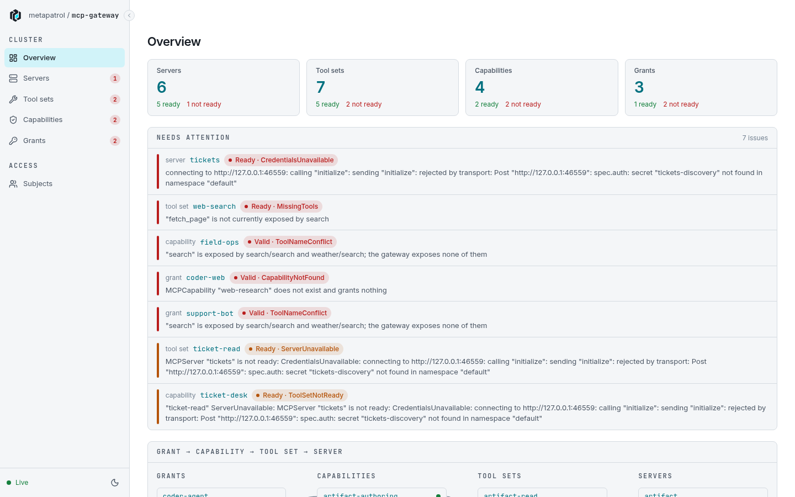
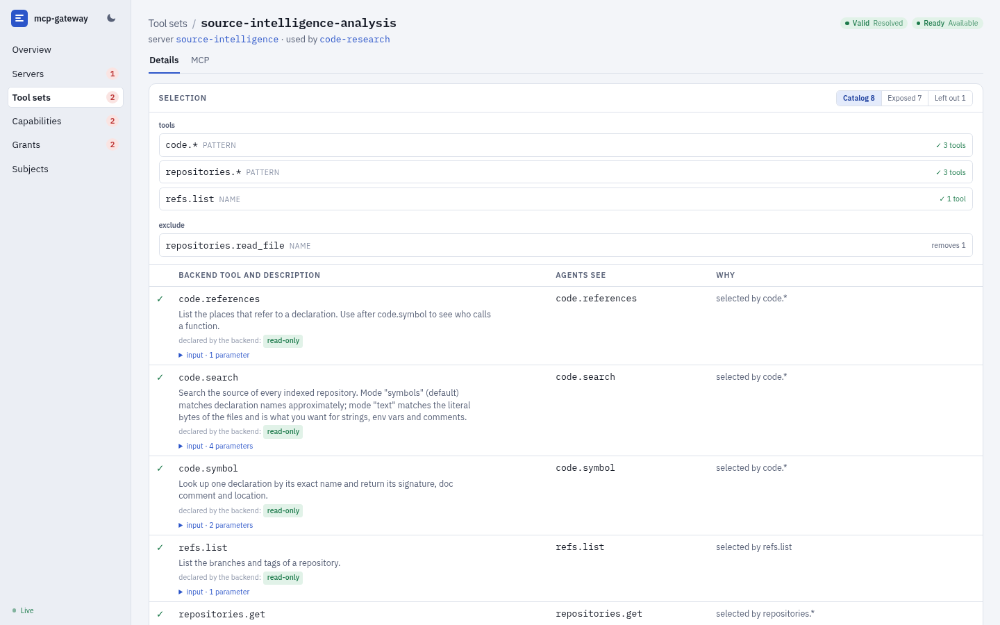
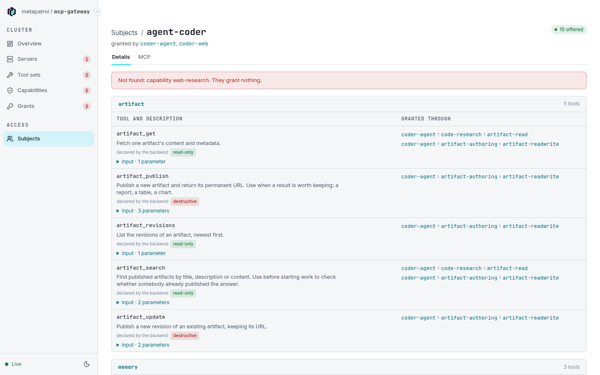
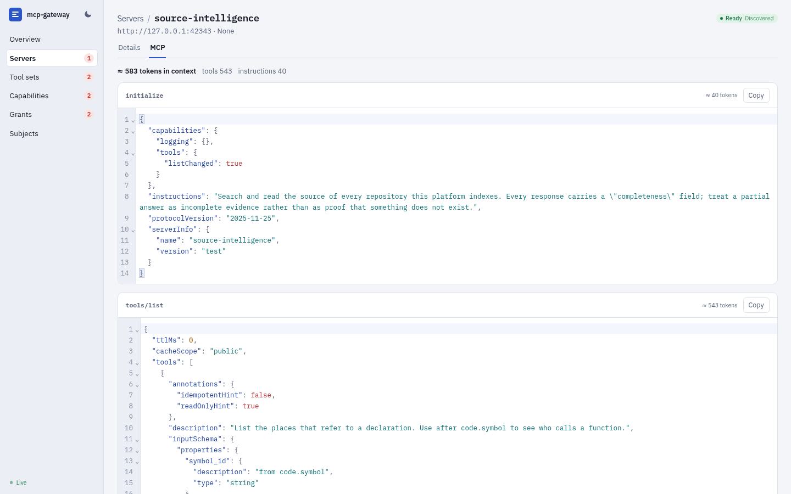
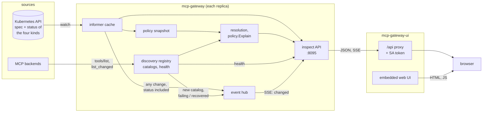
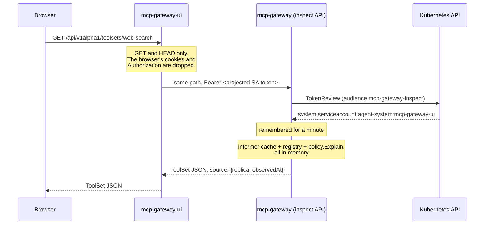
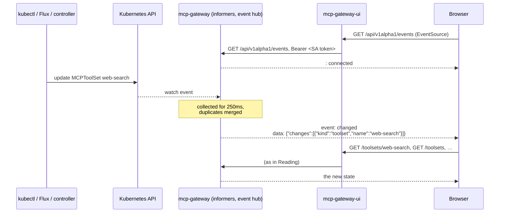

# Console — mcp-gateway-ui

A read-only web console over what the gateway knows: the four kinds, the
backends' catalogs with every tool's description and input schema, and what each
subject is offered. It exists to answer one question without reading YAML and
logs side by side — *does this tool set do what I configured?* — and the ones
that follow from it: what does this subject get, and through which grant; which
backend does an agent's `search` come from; what is an agent told when it starts.

It is optional, runs as a process of its own, and changes nothing.



---

## Enabling it

```yaml
# values of the mcp-gateway chart
ui:
  enabled: true
```

That deploys `mcp-gateway-ui` with a Service and a ServiceAccount of its own,
and turns on the gateway's inspect API, which the console reads:

| What | Why |
|---|---|
| `--inspect-bind-address=:8095` on the gateway, and a Service `<release>-inspect` | The inspect API has a listener and a Service of its own. The MCP port and the address agents are given never lead to it |
| `--inspect-service-accounts=<namespace>/<release>-ui` | The console's ServiceAccount is the one reader the gateway accepts; `gateway.inspect.serviceAccounts` adds more |
| A projected ServiceAccount token for the audience `mcp-gateway-inspect` in the console pod, and no default token | The token opens the inspect API and nothing else, the Kubernetes API included |
| `create` on `tokenreviews` for the gateway | How the gateway checks that token |
| With `networkPolicy.enabled`: the console's pods let in on the gateway's inspect port | Nothing else reaches it |

The gateway's inspect API can also be enabled alone (`gateway.inspect.enabled`,
with `gateway.inspect.serviceAccounts`) for another reader. The chart refuses to
render it without a reader: it is never open to whoever reaches the port.

## Opening it

The console has no sign-in of its own. Who may open it is decided in front of
it:

```bash
kubectl -n mcp-system port-forward svc/mcp-gateway-ui 8080:80
# http://127.0.0.1:8080/
```

or an ingress with an authenticating proxy (oauth2-proxy, or the ingress
controller's own authentication) in front of the `mcp-gateway-ui` Service. It
shows every subject's grants and every backend's tool list; treat access to it
like read access to the four kinds.

## What it shows

Every list — servers, tool sets, capabilities, grants, subjects — can be
searched and sorted by any of its columns. The subjects list is searched,
sorted and cut by the gateway and loads more as it is scrolled, since
resolving a subject is the expensive part of it; the other four come whole.

| Page | Shows |
|---|---|
| Overview | How many of each kind are Ready, everything that is not — the resource at fault first, the ones only passing it on after — and a map from grants through capabilities and tool sets to servers. Hovering a box follows its chain |
| Servers | Endpoint, `spec.auth` with Secrets by name and key only, discovery as the controller reports it and as this gateway replica sees it, the backend's instructions, and its catalog with every tool's description, arguments, and the hints the backend declares for it |
| Tool sets | The entries of `tools`, `exclude`, `prefix` and `aliases` beside the whole catalog, and for every tool whether it is exposed, under which name, and which entry decided it. Selecting an entry marks the tools it selected or removed. The instructions an agent holding the tool set would be sent |
| Capabilities | Its tool sets, the grants that use it, the tools it comes to, name conflicts, and the instructions an agent holding it would be sent |
| Grants | Its subject, its capabilities, the ones that do not exist, the other grants for the same subject, and the instructions an agent holding it would be sent |
| Subjects | For any subject — typed in, or picked from those grants name — every tool it is offered with every path it is granted through, the tools it is not offered and why, and the instructions text it is sent at start: the gateway's own (`gateway.instructions`) followed by those of the backends it holds tools from |





Servers, tool sets, capabilities, grants and subjects each have a second tab,
**MCP**, with what the resource comes to on the wire:

| Page | Shows |
|---|---|
| Tool set, capability, grant | The JSON-RPC responses to `server/discover` and `tools/list` that an agent holding that resource alone receives — envelope, server info, cache scope, supported versions, capabilities, instructions and tools, one `tools/list` response per page |
| Subject | The same for the subject, all of its grants together: what it receives |
| Server | What the backend answered the gateway's discovery — the result of opening the session (its server info, protocol version, capabilities, instructions) and each `tools/list` result, as the MCP SDK read them |

What a page shows is in its URL, so it can be linked to and survives a
reload. The MCP tab is the page's path with `/mcp`, as in the API
(`/servers/search/mcp`, `/subjects/resolve/mcp?subject=agent-coder`); a tool
set's filter and selected entry are `?filter=` and `?focus=`, raw
instructions are `?instructions=raw`, and every list's search and sort are
`?q=` and `?sort=` — a column, `-` in front for descending
(`/servers?sort=-tools`). Sorting by Ready or Valid puts what is not ready
first.



Each MCP view estimates what it costs in a model's context: in total, per
panel, and on hover the heaviest tools. Counted is what an MCP client hands a
model — each tool's name, description and input schema, and the instructions —
not the JSON-RPC envelope around them. The count is `o200k_base`, an open BPE
vocabulary the console loads with the first MCP view; Claude's tokenizer is not
published, so it is an estimate, good for comparing tool sets and finding the
tools that make one heavy, not for budgeting to the token.

The agent's side is not a rendering. The gateway answers it itself
(`GET /api/v1alpha1/{kind}/{name}/mcp`, `GET /api/v1alpha1/subject/mcp`): a
server built as a subject's is, the same registration of each tool, the same
instructions, asked through the same HTTP handler agents reach. A test compares
a grant's view with what an agent holding that grant receives, byte for byte.

Instructions are shown rendered as Markdown, which they usually are, or raw.
They are written by whoever runs a backend, so the rendering does nothing a
backend could use: HTML in them is escaped, never parsed; `javascript:`,
`vbscript:`, `file:` and `data:` links are not made; Angular sanitizes the
result again; and the console's Content-Security-Policy runs no inline script
and loads no image from elsewhere. Links open in a new tab without an opener
or a referrer. Agents receive the text as written; rendering is the console's.

Every detail page is laid out in the same order: what is wrong with the
resource, if anything; what it comes to — its tools, or for a grant its
capabilities; the instructions an agent holding it is sent; what it is made of
and what uses it; and last its conditions, the detail behind the pills at the
top. Notices, the tools, the instructions and the conditions take the full
width; the panels about what a resource is made of and what uses it sit two
to a row, the last one full width when they are odd in number.

Tool hints — read-only, destructive, idempotent, open world — are shown only as
far as the backend declares them, and marked as its claims: the gateway verifies
none of them. A tool that declares nothing says "no hints declared"; MCP then
assumes it may modify and destroy data, which the console does not paint on as
if the backend had said so. `readOnlyHint` and `idempotentHint` count only when
true, because the MCP SDK the gateway reads catalogs with cannot tell a false
from an absent one.


## Data flows

Everything the console shows comes from the gateway's inspect API, and nothing
else: the console has no Kubernetes access and no route to a backend.



Arrows point the way the data goes. Requests go the other way: the browser asks
`mcp-gateway-ui`, which asks the gateway's `<release>-inspect` Service.

### Reading



The gateway answers from memory: the informer cache it watches the four kinds
with, the catalogs it discovered, and the resolution it enforces. A request of
the console costs no call to a backend and no read of the Kubernetes API,
except the TokenReview of a token not seen in the last minute.

### Changes



An event says what changed, never what to: the console reads again through the
same operations it read with the first time, so there is one way the data
reaches it. Every page reloads what it shows on every event; the pages are small
and the gateway answers from memory, so this is cheaper than keeping track of
which event concerns which page.

What produces an event:

| Source | Event |
|---|---|
| Any add, update or delete of one of the four kinds the replica's informers see — spec, status, labels | `{kind, name}` of that resource |
| A backend's catalog changes on this replica (a tool added, removed, or redefined; new instructions) | `{kind: server, name}` |
| A backend's discovery starts or stops failing on this replica | `{kind: server, name}` |

What does not: the controller's routine write of `status.lastDiscoveryTime`
after a discovery that found what the last one found. Announcing it would have
every console read again once per discovery interval per server.

When the stream is down — the gateway restarting, a proxy closing it — the
browser reconnects by itself and reads everything again, since nothing is
replayed. When the gateway refuses a stream (more than 100 open on a replica),
the console polls every 30 seconds and asks again later. While the stream is up
it still reads everything every five minutes, for what no event announces: a
catalog that ages out of use after `--catalog-max-age` while its backend stays
down. The sidebar says which of these is the case.

### Replicas

Each answer, and each stream, comes from one gateway replica, and says which
(`source.replica`, shown above a server's discovery comparison). The Kubernetes side is the same on
every replica. The catalogs are each replica's own discovery, so two replicas
can differ for up to a discovery interval; a tool set page says so when the
controller's status and the answering replica disagree about what it resolves
to.

## Other readers

The console is one reader of the inspect API; anything that holds a token for
it can be another. An OpenAPI-to-MCP translator, for one, turns the API into
tools an agent can call, to check what it or another subject is offered. It
needs:

- the description, from `/.well-known/api-catalog` or
  `/api/v1alpha1/openapi.json`, both readable without a token. Every
  operation's `description` is written to serve as a tool description.
  Leave out `watchEvents`, a stream that is no tool call, and the two
  operations returning the description itself;
- a ServiceAccount token projected for the audience `mcp-gateway-inspect`,
  and that ServiceAccount in `gateway.inspect.serviceAccounts`:

  ```yaml
  volumes:
    - name: inspect-token
      projected:
        sources:
          - serviceAccountToken:
              audience: mcp-gateway-inspect
              expirationSeconds: 3600
              path: token
  ```

- with `networkPolicy.enabled`, its pods let in on the inspect port through
  `networkPolicy.inspectNamespaceSelector` and `inspectPodSelector`.

Registered as an MCPServer behind the gateway, its tools are granted like any
other. The inspect API then sees the translator, not the agent calling
through it: whoever is granted those tools reads every subject's grants and
every backend's catalog. Grant them to the agents that may.

## Developing it

```bash
make dev-stack
```

runs the whole chain on one machine and keeps it running until Ctrl-C: a
Kubernetes API server with the CRDs (envtest), six MCP backends in-process,
the controller, the gateway with its inspect API and event stream, and the
console at http://127.0.0.1:8480/. The example resources cover every state the
console has a way of showing: a backend whose credentials are missing, a tool
set naming a tool its backend lacks, two tool sets exposing `search` to one
subject, a grant naming a capability that does not exist, and a tool set with
exclusions, a prefix and an alias. It writes a kubeconfig for its API server:

```bash
kubectl --kubeconfig /tmp/mcp-gateway-dev-stack.kubeconfig edit mcptoolset web-search
```

and the console follows the edit as it is saved. The inspect API accepts every
caller there — there is no token to review — and the MCP endpoint takes the
subject as its bearer token.

For work on the UI itself, `npm start` in `web/ui` serves it with live reload on
http://localhost:4200/ and passes `/api` on to the dev stack. The UI needs
Node ≥ 22.22.3, and its `@metapatrol/*` packages (the shell, components and
styles every metapatrol console shares) come from the forge's npm registry:
export a Forgejo token with `read:package` scope as `NPM_TOKEN` before
`make ui-install` (`web/ui/.npmrc`), and point `NODE_EXTRA_CA_CERTS` at the
platform CA where the system does not trust it.

| Command | Does |
|---|---|
| `make ui-build` | Generates the API client and builds the UI into `internal/ui/dist/ui`, which `mcp-gateway-ui` embeds |
| `make ui-test` | The UI's unit tests (Vitest) |
| `make ui-lint` | ESLint over the UI |
| `make generate-api` | The Go side of the inspect API, from its spec |
| `make lint-api` | Redocly over the spec |

The spec, [`api/openapi/inspect.yaml`](../api/openapi/inspect.yaml), is where a
change to the API starts. The Go server interface and the UI's client are both
generated from it — the Go code committed and checked by a test, the UI's client
on every build and never committed — so neither can drift from it. The gateway serves
it too, without a token, at `/api/v1alpha1/openapi.yaml` and `openapi.json`,
and names both in `/.well-known/api-catalog`; the console passes all three on.
