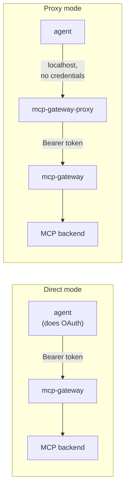
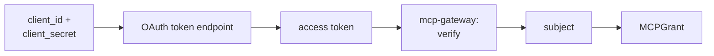
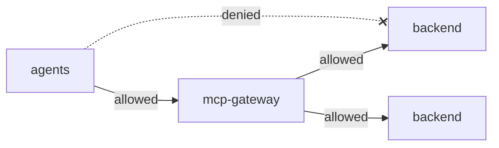
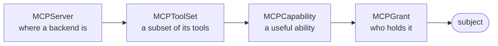
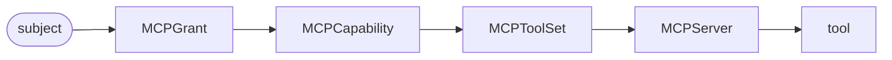
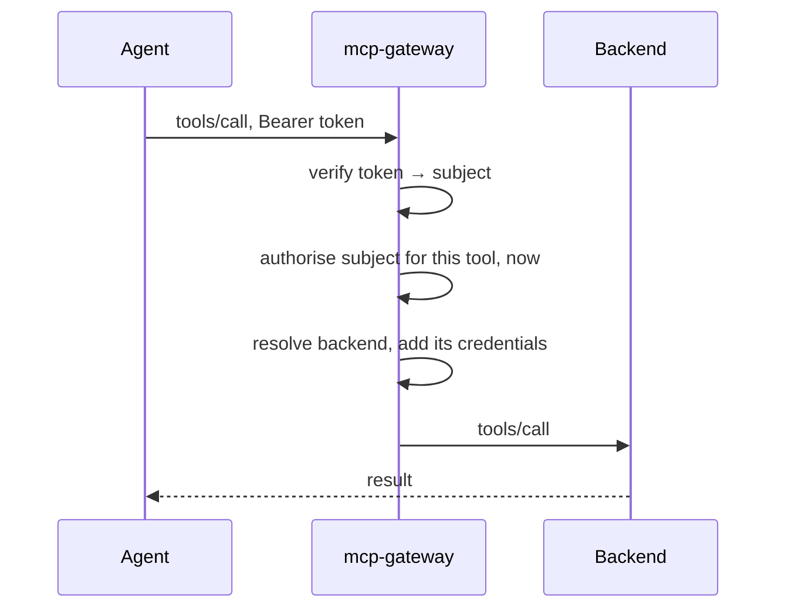
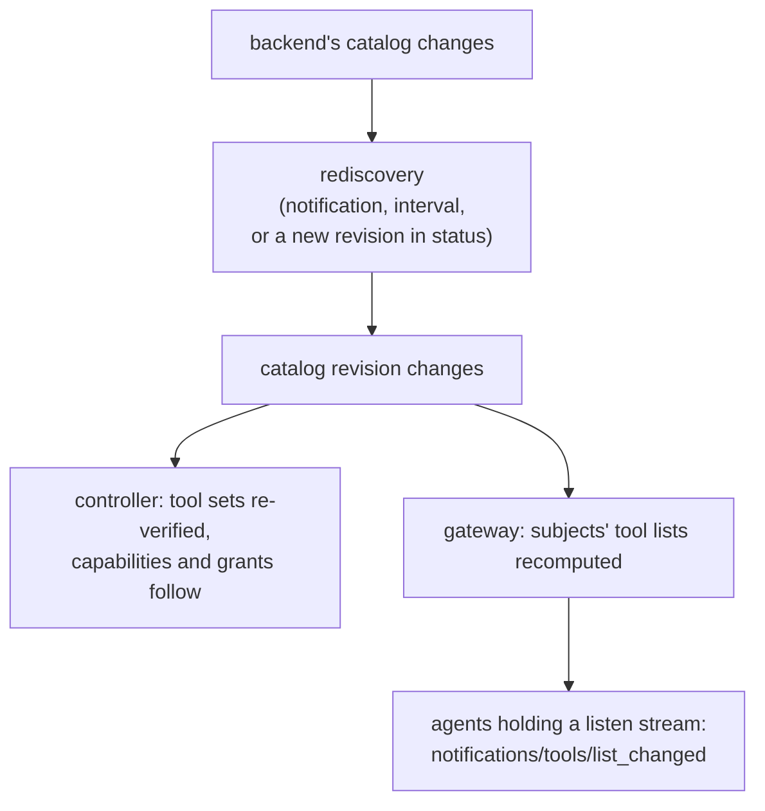

# Design

The design record of mcp-gateway: what it is for, the model it enforces, and
the decisions behind both. [Architecture](architecture.md) describes how the
implementation carries them out.

**Contents**

1. [Purpose](#1-purpose)
2. [Components](#2-components)
3. [Access modes](#3-access-modes)
4. [Authentication](#4-authentication)
5. [Network model](#5-network-model)
6. [The Kubernetes API](#6-the-kubernetes-api)
7. [MCPServer](#7-mcpserver)
8. [Discovery](#8-discovery)
9. [MCPToolSet](#9-mcptoolset)
10. [Verification](#10-verification)
11. [MCPCapability](#11-mcpcapability)
12. [MCPGrant](#12-mcpgrant)
13. [Aggregation](#13-aggregation)
14. [Tool names](#14-tool-names)
15. [Request flow](#15-request-flow)
16. [Credentials towards backends](#16-credentials-towards-backends)
17. [Change detection](#17-change-detection)
18. [Failure behaviour](#18-failure-behaviour)
19. [Non-goals](#19-non-goals)
20. [Naming](#20-naming)
21. [Principles](#21-principles)

---

## 1. Purpose

mcp-gateway is a Kubernetes-native control and data plane that puts many
Model Context Protocol (MCP) backends behind one governed access layer. It
exists to:

- give agents one MCP endpoint,
- aggregate the tools of many MCP backends,
- expose only approved subsets of those tools,
- compose reusable capabilities from those subsets,
- bind capabilities to authenticated subjects,
- keep authentication, authorisation, routing and backend credentials in one
  place,
- serve agents that do OAuth themselves and agents that need a local endpoint
  without authentication,
- discover what backends offer, instead of copying tool definitions into
  Kubernetes resources.

It is not an MCP reverse proxy. It is an access and capability layer, and
Kubernetes is its desired-state API.

## 2. Components

| Component | Role |
|---|---|
| `mcp-gateway-controller` | The control plane. Discovers the tools of registered backends, verifies tool selections against them, reports status on all four kinds. **Never in the request path.** |
| `mcp-gateway` | The data plane and the enforcement point. Authenticates callers, resolves their subject and grants, serves the filtered aggregate `tools/list`, authorises every `tools/call`, adds backend credentials, forwards, audits. |
| `mcp-gateway-proxy` | Optional. A local adapter for agents that cannot do OAuth: an endpoint without authentication on loopback that obtains and refreshes tokens. **Convenience, not a security boundary**: it holds no policy and no backend credentials. |
| `mcp-gateway-ui` | Optional. A read-only console over the four kinds, the backends' catalogs and what each subject gets, reading the gateway's inspect API. Changes nothing. |

## 3. Access modes

Two client modes, and the gateway cannot tell them apart:



The gateway behaves identically in both. Nothing in it depends on whether the
caller is an agent or a proxy.

## 4. Authentication

Agents authenticate with **OAuth 2.0 access tokens**, typically from the
client credentials grant. The gateway verifies a token — as a JWT against the
provider's key set, or by RFC 7662 introspection — and derives one stable,
opaque **subject** from a configurable claim.



The provider is an implementation detail. The gateway reads registered claims
and one configurable claim, and nothing provider-specific; it is used with Ory
Hydra, and nothing in it depends on Hydra.

Authentication and authorisation stay separate: the token says who is calling,
`MCPGrant`s say what that subject may use. Scopes are recorded, never used to
authorise.

Agents speak **MCP 2026-07-28**, which has no sessions: every request carries
its own token and is authenticated on its own. Clients of the older,
session-based versions are refused; there is no compatibility layer for a
superseded specification.

→ [Authentication](authentication.md)

## 5. Network model

The gateway is the network boundary between agents and backends. Agents do
not need to reach backends, and should not be able to:



NetworkPolicies allow agent → gateway and gateway → backends, and deny
agent → backend. That makes the gateway the one place where access is
enforced and backend credentials are held. The proxy is never the boundary.

→ [Architecture: network model](architecture.md#network-model)

## 6. The Kubernetes API

Four kinds, each one concern, in `mcp-gateway.metapatrol.com/v1alpha1`, all
cluster-scoped:



Cluster scope is deliberate. Whoever may create an `MCPServer` decides where
the gateway's reach is pointed, and whoever may create an `MCPGrant` decides
who uses it; a subject is not issued to a namespace. A namespaced model would
let any tenant register another team's backend and grant themselves access to
it. → [Architecture: cluster scope](architecture.md#cluster-scope)

## 7. MCPServer

Registers a backend: where it is, and how to authenticate to it. It never
lists tools.

```yaml
apiVersion: mcp-gateway.metapatrol.com/v1alpha1
kind: MCPServer
metadata:
  name: source-intelligence
spec:
  endpoint: http://source-intelligence.mcp-system.svc/mcp
```

`spec` is desired connection configuration. The tool catalog is discovered
from the backend (§8), and credentials are described by `spec.auth` (§16).

## 8. Discovery

The controller and every gateway replica read a backend's catalog through MCP
itself — open a connection, `tools/list` — and keep it in memory.

The catalog is not a second source of truth, and the Kubernetes API is not a
cache for tool schemas, which can run to megabytes. `MCPServer.status` stays
compact:

```yaml
status:
  available: true
  discoveredTools: 17
  catalogRevision: sha256:…
  lastDiscoveryTime: …
```

The revision is a hash over the tool definitions and the backend's
instructions, so a changed description is a changed catalog.

## 9. MCPToolSet

A curated subset of the tools of **exactly one** server: a reusable technical
toolbox.

```yaml
apiVersion: mcp-gateway.metapatrol.com/v1alpha1
kind: MCPToolSet
metadata:
  name: source-intelligence-analysis
spec:
  serverRef: source-intelligence
  tools: [code.*, repositories.*, refs.list]
  exclude: [repositories.read_file]
```

Tools are selected by name or by glob pattern, with exclusions that win. A
pattern selects what the backend offers *now*, including tools it adds later;
`status.resolvedTools` always shows the current selection. A tool set may also
rename what it selects, with a `prefix` or `aliases` (§14).

Cross-server composition belongs to `MCPCapability`, not here.

## 10. Verification

The controller verifies each tool set against the discovered catalog of its
server, and reports two conditions on every kind:

| Condition | Means |
|---|---|
| `Valid` | The declaration is structurally sound: what it references exists, nothing is claimed twice. |
| `Ready` | What it references is available now: the backend answers, the named tools exist, the patterns select something. |

```text
invalid configuration          → Valid=False
backend unavailable            → Valid=True,  Ready=False  (ServerUnavailable)
a named tool is not exposed    → Valid=True,  Ready=False  (MissingTools)
every selected tool available  → Valid=True,  Ready=True
```

```yaml
status:
  conditions:
    - type: Valid
      status: "True"
    - type: Ready
      status: "False"
      reason: MissingTools
      message: '"symbol_search" is not currently exposed by source-intelligence'
```

Verification explains; it does not enforce. The gateway builds its policy from
the manifests, never from status, and checks every call itself.

→ [CRD Reference](crd-reference.md) for every reason

## 11. MCPCapability

Combines tool sets into a useful ability, and may span backends:

```yaml
apiVersion: mcp-gateway.metapatrol.com/v1alpha1
kind: MCPCapability
metadata:
  name: code-research
spec:
  description: Read and search source code, and read published artifacts.
  toolSets: [source-intelligence-analysis, artifact-read]
```

Capabilities name what an agent can do — `code-research`, `code-review`,
`artifact-authoring`, `cluster-observation` — not how backends are laid out.

## 12. MCPGrant

Assigns capabilities to a subject:

```yaml
apiVersion: mcp-gateway.metapatrol.com/v1alpha1
kind: MCPGrant
metadata:
  name: coding-agent
spec:
  subject: coding-agent
  capabilities: [code-research, artifact-authoring]
```

The subject is opaque to the API. Which claim it came from is the gateway's
configuration, not the resource's: there is no `subject.oauthClient.clientId`.
Several grants may name one subject; it gets the union.

Resolution runs the chain backwards:



## 13. Aggregation

The gateway offers each caller one catalog, assembled from the backends its
grants reach and nothing else. With these backends

```text
source-intelligence:  source_search  source_get  symbol_search  repository_search
artifact:             artifact_search  artifact_get  artifact_publish
```

a subject holding `source-intelligence-analysis` and `artifact-read` sees

```text
source_search  source_get  symbol_search  artifact_search  artifact_get
```

It never sees a tool outside its grants — not in `tools/list`, not in the
instructions it is sent, not in the error a call to such a tool returns.

Backends' `instructions` are passed on too, but only of backends the subject
holds a tool from, after a text of the gateway's own.

## 14. Tool names

Internally every tool is identified by its backend: `artifact/artifact_search`.
Agents see plain names, and backend prefixes are not forced on them.

When two backends name a tool alike and one subject is granted both, the
gateway exposes **neither**, and the capability or grant reports
`ToolNameConflict`. A tool set resolves the collision by renaming — every tool
behind a `prefix`, or individual `aliases` — while its selection keeps using
the backend's names.

## 15. Request flow

**`tools/list`** is answered from the subject's tool list, which the gateway
keeps current as manifests and catalogs change. A slow or failing backend does
not hold up the others: its tools stay listed for the gateway's `--catalog-max-age` and then drop
out until discovery succeeds again.

**`tools/call`** is authorised again, on every call, against the current
policy and the token on that request:



A tool seen in an earlier `tools/list` is not a licence to call it later. A
grant revoked a moment ago is refused, even if the list has not caught up.

## 16. Credentials towards backends

Agent credentials and backend credentials are separate. The agent's token is
**not** forwarded to backends, unless a backend explicitly asks for exactly
that. `MCPServer.spec.auth` says, per backend:

| `type` | The backend sees |
|---|---|
| `None` | no credentials |
| `ClientCredentials` | a token for the gateway's own OAuth client |
| `APIKey` | a static key from a Secret |
| `Passthrough` | the calling agent's own token, on that agent's calls only |

Secrets are referenced by name and key and read only from the gateway's own
namespace: a cluster-scoped resource that could name a Secret anywhere would
let whoever may create one read any Secret in the cluster.

Token exchange, mTLS and workload identity would be further variants of the
same union; none is implemented yet.

→ [Authentication: towards backends](authentication.md#towards-backends)

## 17. Change detection

When a backend's catalog changes, both components notice, and what follows
from it is recomputed:



A backend that sends `notifications/tools/list_changed` is read again at once;
the others on their `discoveryInterval`. A rediscovery that finds the same
catalog changes nothing and notifies no one.

## 18. Failure behaviour

One broken backend must not become a global outage, and nothing unresolved
may widen access.

| Situation | Outcome |
|---|---|
| A backend is unavailable | Its tools drop out after the gateway's `--catalog-max-age`; other backends are unaffected. Its tool sets go `Ready=False`. |
| A named tool disappears | It is no longer exposed; the rest of its tool set is. `MissingTools`. |
| A grant names a missing capability | That name grants nothing; the rest of the grant applies. `Valid=False`. |
| Two tools claim one name | Neither is exposed. `ToolNameConflict`. |
| The controller is down | Nothing changes for agents; status goes stale. |

**Fail closed**: an invalid or unresolved reference can narrow access, never
broaden it. → [Architecture: failure behaviour](architecture.md#failure-behaviour)

## 19. Non-goals

Deliberately left out, unless a need proves otherwise:

- API keys or anything but OAuth access tokens **for agents**,
- policy languages, attribute-based access control, conditional per-tool rules,
- inheritance between grants, grant overrides,
- tool definitions persisted in a resource's spec,
- per-agent gateway deployments, mandatory sidecars,
- plugins or code executed inside the gateway,
- backend-specific code in the gateway: adding a backend takes registration
  and policy, not a gateway change,
- logic specific to an OAuth provider,
- prompts, resources, sampling and elicitation: the gateway aggregates tools.

It stays small and deterministic.

## 20. Naming

| Name | Is |
|---|---|
| mcp-gateway | the project, and the data plane — what agents talk to takes the plain name |
| mcp-gateway-controller | the control plane |
| mcp-gateway-proxy | the optional local OAuth adapter |
| mcp-gateway-ui | the optional console |
| `mcp-gateway.metapatrol.com` | the API group |
| `MCPServer`, `MCPToolSet`, `MCPCapability`, `MCPGrant` | the kinds |

## 21. Principles

1. **One source of truth.** Tool definitions come from the backends
   themselves.
2. **Discovery over duplication.** Catalogs are discovered, never copied into
   resources.
3. **Authentication is not authorisation.** OAuth establishes a subject;
   `MCPGrant` authorises it.
4. **The gateway is the enforcement point.** Controller-side verification
   improves correctness and never replaces authorisation at runtime.
5. **The controller is not in the request path.** The gateway keeps working
   when the controller does not.
6. **The proxy is optional**, and **not a security boundary**.
7. **Capabilities are independent of backends**, and may combine several.
8. **Tool sets are local to one backend.**
9. **Fail closed.** Nothing unresolved results in broader access.
10. **Backends stay autonomous.** The gateway routes to existing MCP servers;
    it does not reimplement them.
11. **Kubernetes is the desired-state API.** Runtime catalogs and large
    schemas do not become persistent objects.
